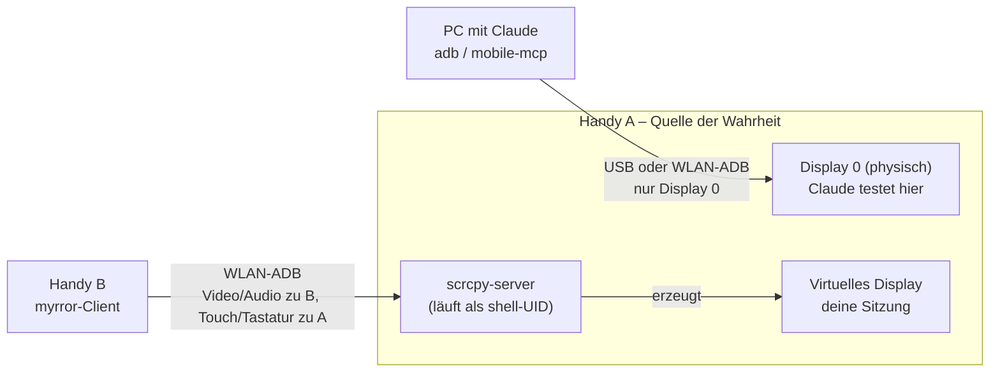

# Evaluation: Zwei Android-Handys „vollumfänglich“ parallel nutzen

Stand: 17.10.2026 · Status: Evaluation abgeschlossen, Entscheidung offen

## 1. Problemdefinition

Ausgangslage: Ein Alltags-Handy (im Folgenden **Handy A**) wird zeitweise als
Testgerät belegt, etwa weil Claude per ADB Apps automatisiert testet. In dieser
Zeit sollen Apps, Konten, Daten und Zustand von Handy A auf einem zweiten Gerät
(**Handy B**) nahtlos weiter nutzbar sein.

Dafür gibt es zwei grundverschiedene Architekturen. Diese Unterscheidung
entscheidet über die Machbarkeit:

| Architektur | Prinzip | Analogie |
|---|---|---|
| **Replikation** (Active-Active) | Beide Geräte halten denselben Zustand und gleichen ihn laufend ab. | Datenbank-Cluster mit zwei Schreibknoten |
| **Projektion** (Single Source of Truth) | Ein Gerät hält den Zustand, das zweite ist ein Fenster darauf (Thin Client). | Remote Desktop / VDI |

## 2. Kurzfazit

1. **Echte Replikation zweier Android-Geräte in Echtzeit ist nicht machbar**,
   weder ohne noch mit Root in stabiler Form (Begründung in Abschnitt 3). Keine
   App und kein Repo kann das lösen. Das liegt an der Sicherheitsarchitektur von
   Android, nicht an fehlendem Code.
2. **Projektion ist machbar, und zwar ohne Root.** Auf Handy A läuft ein
   **zweites, virtuelles Display**, das auf Handy B gestreamt und von dort
   bedient wird. Claude testet auf dem physischen Display, du arbeitest
   gleichzeitig auf dem virtuellen. Beide sitzen auf demselben Gerät, also mit
   denselben Apps, Konten und Daten. Ab **Android 14** erzeugt scrcpy dieses
   Display mit eigenem Fokus, eigenem Energiezustand und ohne Sperrbildschirm.
   Damit ist Android 14 die technische Schwelle, ab der das Konzept wirklich
   trägt.
3. Die Projektion deckt geschätzt **85–90 % der Alltagsnutzung** ab. Lücken
   bleiben bei FLAG_SECURE-Apps (Banking, Passwortmanager, DRM), Mikrofon,
   Kamera, NFC, Biometrie und Telefonie. Diese Lücken schließt man nicht
   technisch, sondern organisatorisch, mit **Föderation**: Multi-Device-Apps
   direkt auf Handy B und MultiSIM für Anrufe.
4. Den größten Hebel hat ohnehin die **Rollentrennung**: Tests, die kein echtes
   Gerät brauchen, laufen auf dem Emulator. Dann muss Handy A gar nicht erst
   belegt werden.
5. **Ein Repo ist sinnvoll.** Die Lösung besteht aus mehreren Teilen:
   Host-Skripte, Schutzregeln für Claudes Testwerkzeuge, ein Client für Handy B
   und Doku. Eine einzelne App ist das nicht (Abschnitt 8).

**Empfehlung:** Hybrid aus Projektion (Kern von myrror), Rollentrennung und
Föderation. Als Nächstes folgt ein PoC von etwa 1–2 Stunden mit Standard-scrcpy
am PC, bevor Code entsteht (Abschnitt 7, Phase 0).

## 3. Warum echte Replikation nicht geht

| Hürde | Auswirkung |
|---|---|
| **App-Sandbox** | Die Daten jeder App (`/data/data/<paket>`) gehören deren UID. Ohne Root gibt es keinen Zugriff. `adb backup` ist für aktuelle Apps faktisch tot. |
| **Hardware-gebundene Schlüssel** (Keystore, TEE, StrongBox) | Schlüssel für Banking, Passkeys, Wallet und Messenger-Identität sind nicht exportierbar. Eine Kopie der App-Daten ist auf einem anderen Gerät wertlos oder wird als Angriff gewertet. |
| **Gerätebindung und Integrität** (Play Integrity, Bank-Device-Binding) | Dieselbe Sitzung taucht auf zwei Geräten auf, also werden Sessions invalidiert, Konten gesperrt oder die App verweigert den Start. |
| **Konflikte** | Zwei aktive Kopien einer App-Datenbank (SQLite) ohne Unterstützung durch die App führen zu Split-Brain und Datenkorruption. Echtzeit-Sync ohne App-Protokoll ist ungelöst. |
| **Telefonie** | Rufnummer und SMS hängen netzseitig an einer SIM bzw. eSIM. |
| **Root-Werkzeuge** (Swift Backup u. ä.) | Sie liefern nur Snapshots, keine Echtzeit, und brechen genau die obigen Bindungen. |

**Konsequenz:** Zustand lässt sich nur dort replizieren, wo die App es selbst
anbietet, also per Föderation (Option O1).

## 4. Optionen im Überblick

| # | Option | Prinzip | Abdeckung | Aufwand | Konflikt mit Tests | Urteil |
|---|---|---|---|---|---|---|
| O1 | **Föderation** | Multi-Device-Apps und MultiSIM, beide Geräte eigenständig | ~70 % (nur Apps mit Multi-Device-Unterstützung) | gering | keiner | **Pflicht-Basis** |
| O2 | **Projektion über virtuelles Display** | Handy B bedient ein zweites Display von Handy A | ~85–90 % | mittel | keiner, mit Display-Guard (5.4) | **Kern von myrror** |
| O3 | **Rollentrennung** | Tests auf Emulator oder separatem Testgerät, Handy A bleibt frei | Problem entfällt für die meisten Tests | gering | entfällt | **Größter Hebel** |
| O4 | **Android-Container als „eigentliches Handy“** (redroid, Cuttlefish) | Beide physischen Handys sind Thin Clients eines Server-Androids | Theoretisch symmetrisch, praktisch schwach | hoch | keiner | ✗ Nicht als Alltagsgerät: keine Telefonie, Sensoren oder NFC; Google-Dienste fehlen standardmäßig, Banking und Play Integrity sind unsicher |
| O5 | **Klassische Fernsteuerung** (TeamViewer, AnyDesk, RustDesk, AirDroid, scrcpy auf Display 0) | Spiegelt das **Haupt**display | ~90 % | gering | **massiv**: du und Claude bedient dasselbe Display | ✗ Ungeeignet |
| O6 | **OS-Funktionen** (Android 17 „Continue On“, Samsung-Ökosystem) | Übergabe einzelner Aufgaben | punktuell | keiner | keiner | Später ergänzend. „Continue On“ startet laut Berichten zunächst nur Handy↔Tablet und braucht App-Unterstützung. |

Kernerkenntnis zu O5: **Jede Lösung, die das Hauptdisplay spiegelt,
kollidiert zwingend mit den Tests.** Du brauchst ein *zweites* Display auf
Handy A. Genau das liefert O2.

## 5. Deep Dive O2: Projektion über virtuelles Display

### 5.1 Architektur



- scrcpy (Genymobile, Apache-2.0, aktuell v5.0.1 vom 08.10.2026) kann seit
  v3.0 mit `--new-display` ein **neues virtuelles Display** anlegen, darauf Apps
  starten, es streamen und steuern. Das geht ohne Root und ohne App auf
  Handy A, denn der Server wird per ADB als `app_process` gestartet.
- Seit v4.0 passt `--flex-display` die Displaygröße dynamisch an das
  Client-Fenster an. Für Handy B als Client mit eigener Auflösung oder Rotation
  ist das ideal.
- `--display-ime-policy=local` (seit v3.2) zeigt die Bildschirmtastatur im
  virtuellen Display an, also bei dir auf Handy B.
- Handy B braucht einen Client, der das scrcpy-Protokoll spricht und
  Videodecodierung (MediaCodec) sowie Eingaben übernimmt (Abschnitt 5.5).

### 5.2 Android-Version von Handy A ist der entscheidende Faktor

Die Analyse des scrcpy-Quellcodes (`NewDisplayCapture.java`) zeigt: Wie
brauchbar das virtuelle Display ist, hängt von der Android-Version ab.

| Android (Handy A) | Flags, die scrcpy setzt | Bedeutung für dich |
|---|---|---|
| < 10 | – | Apps lassen sich praktisch nicht zuverlässig auf sekundären Displays starten. ✗ |
| 10–12 | `PUBLIC`, `PRESENTATION`, `OWN_CONTENT_ONLY`, `SUPPORTS_TOUCH`, `ROTATES_WITH_CONTENT` | Funktioniert, aber mit gemeinsamem Sperrbildschirm, gemeinsamem Energiezustand und gemeinsamem Fokus. Eingeschränkt nutzbar. |
| 13 | zusätzlich `TRUSTED`, `OWN_DISPLAY_GROUP`, `ALWAYS_UNLOCKED` | Eigener Energiezustand: Display 0 darf aus sein, deine Sitzung läuft weiter. Kein Sperrbildschirm auf dem virtuellen Display. |
| **≥ 14** | zusätzlich **`OWN_FOCUS`** | **Eigener Eingabefokus.** Deine Tastatureingaben und Claudes Eingaben laufen getrennt. **Empfohlen.** |

Aus den AOSP-Quellen (`DisplayManager.java`):

- `ALWAYS_UNLOCKED`: „should always be unlocked and not have keyguard displayed
  on it“, gültig nur außerhalb der Standard-Display-Gruppe. Bequem, aber
  sicherheitsrelevant (Abschnitt 5.6).
- `OWN_FOCUS`: „maintains its own focus and touch mode“, analog zu
  `config_perDisplayFocusEnabled`, aber nur für dieses Display.

### 5.3 Was funktioniert, was nicht

| Bereich | Status über Projektion | Kompensation |
|---|---|---|
| Alle normalen Apps, Konten und Daten von A | ✅ in Echtzeit, Latenz typischerweise 35–70 ms (scrcpy-Angabe) | – |
| Tastatur, Zwischenablage | ✅ (IME lokal im virtuellen Display, Clipboard über scrcpy) | – |
| Ton von A auf B | ✅ ab Android 11 (bei Android 11 muss A beim Start entsperrt sein) | – |
| **Mikrofon von B zu A** | ❌ scrcpy überträgt kein Mikrofon vom Client zum Gerät (Sprachnachrichten, VoIP) | O1: Messenger direkt auf B |
| **FLAG_SECURE-Fenster** (Banking, Passwortmanager, Netflix, manche Messenger-Ansichten) | ❌ werden im Stream schwarz. Sichere virtuelle Displays kann scrcpy nur bis Android 11 erzeugen. | O1: Banking und Passwortmanager zusätzlich auf B (viele Banken erlauben 2–3 Geräte) |
| Kamera, NFC/Google Wallet, Fingerabdruck, GPS von B | ❌ es gelten die Sensoren von A | O1: Wallet auf B. Biometrie-Abfragen über den Stream sind unzuverlässig. |
| Anrufe, SMS | ❌ hängen an der SIM von A | O1: MultiSIM (Anrufe klingeln parallel, SMS gehen an genau eine wählbare Karte) oder Rufumleitung |
| Benachrichtigungen | ⚠️ Virtuelle Displays haben auf Handys in der Regel keine Statusleiste bzw. keinen Benachrichtigungsschirm | myrror-Komponente „Notification-Bridge“ (Phase 3) oder O1 |
| Launcher im virtuellen Display | ⚠️ geräteabhängig | Fallback: `--start-app=org.fossify.home --no-vd-system-decorations` |
| Dieselbe App gleichzeitig auf beiden Displays | ⚠️ in der Regel nicht möglich, eine Task liegt auf genau einem Display | Unkritisch: Claude testet die Dev-App, du nutzt den Rest. |
| OEM-Varianten (Samsung One UI, Xiaomi HyperOS) | ⚠️ abweichendes Verhalten möglich; scrcpy hatte Fixes für Android 16 und Desktop-Features | im PoC prüfen |

### 5.4 Kritisches Risiko: Claudes Eingaben landen in deiner Sitzung

Das ist der wichtigste technische Befund dieser Evaluation, belegt mit
AOSP-Quellcode:

- `adb shell input` (`InputShellCommand.java`): **Touch- und Mausereignisse**
  gehen ohne `-d` an Display 0. **Tastenereignisse und `input text`** gehen ohne
  `-d` an `INVALID_DISPLAY`, also an das **aktuell fokussierte Top-Display**.
- `uiautomator dump` (`DumpCommand.java`) liest ohne `--windows` das **aktive
  Fenster** (`getRootInActiveWindow()`), nicht gezielt Display 0.
- scrcpy setzt **nicht** `VIRTUAL_DISPLAY_FLAG_STEAL_TOP_FOCUS_DISABLED`
  (Android 15+, `@SystemApi`). Das virtuelle Display kann also das Top-Fokus-
  Display werden, sobald du es berührst.
- `mobile-mcp` (gängiger MCP-Server für Android-Tests) nutzt `input text`,
  `input keyevent` und `uiautomator dump` ohne Display-Angabe.

**Folge ohne Gegenmaßnahme:** Tippt Claude Text oder liest den UI-Baum,
während du auf Handy B aktiv bist, kann der Text in **deiner** App landen
(etwa in einem offenen Chat), oder Claude liest **deinen** Bildschirminhalt.
Das ist ein Datenschutzproblem und ein Funktionsproblem zugleich.

**Gegenmaßnahme (myrror-Komponente „Display-Guard“):**

1. Claudes Testwerkzeuge auf Display 0 festnageln: `input -d 0 …`,
   `uiautomator dump --windows` mit Filter auf Display 0 (alternativ
   UiAutomator ≥ 2.3 mit `By.displayId`), `screencap -d <id>`.
   Umsetzbar als ADB-Shim oder Patch bzw. Konfiguration des MCP-Servers.
2. Regel in `CLAUDE.md`: Tests ausschließlich auf Display 0, nie
   `--display` eines virtuellen Displays.
3. Optional prüfen, ob ein eigener Server-Build das Flag
   `STEAL_TOP_FOCUS_DISABLED` als shell-UID setzen darf (PoC).

### 5.5 Client auf Handy B

| Variante | Beschreibung | Bewertung |
|---|---|---|
| **a) EasyControlNext** (Fork von Easycontrol, GPL-3.0) | Android-zu-Android-Steuerung auf scrcpy-Basis, eingebautes ADB, Pairing-Code ab Android 11, letzte Aktivität März 2026 | Schnellster Weg. **Ob `new-display` unterstützt wird, ist offen** und muss im PoC geprüft werden. Notfalls Fork und Erweiterung. Warnung der Autoren: Die App kann Bildschirm-Timeout und Auflösung des Zielgeräts verändern. |
| **b) Eigener myrror-Client** (Kotlin) | Eigene App mit offiziellem `scrcpy-server`, ADB-Bibliothek, MediaCodec-Dekodierung und Touch-Mapping | Volle Kontrolle (Flex-Display, Auto-Reconnect, Notification-Bridge). Aufwand: Wochen statt Tage. |
| c) PC als Relay | Handy B verbindet sich zum PC, der PC per USB zu A | Nur als Fallback, wenn A kein WLAN-ADB kann. Mehr bewegliche Teile. |

**Topologie-Empfehlung:** Handy B verbindet sich **direkt per WLAN-ADB** mit
Handy A. adbd akzeptiert parallel die USB-Verbindung des PCs und
TCP-Verbindungen. Damit hängt deine Nutzung nicht davon ab, dass der PC läuft.

### 5.6 Sicherheit

- ADB bedeutet volle Gerätekontrolle. Es gehört **nur ins Heimnetz** bzw.
  hinter ein VPN (z. B. Tailscale/WireGuard für unterwegs), nie offen ins
  Internet.
- Ab Android 13 hat das virtuelle Display **keinen Sperrbildschirm**
  (`ALWAYS_UNLOCKED`). Wer die Verbindung hat, hat eine entsperrte Sitzung.
  Deshalb braucht es einen expliziten Kill-Switch (Sitzung beenden) und
  Auto-Disconnect bei Netzwechsel.
- WLAN-Debugging mit Pairing (ab Android 11) ist `adb tcpip 5555` vorzuziehen.
- Der Display-Guard (5.4) ist auch eine Datenschutzmaßnahme gegenüber dem
  Testwerkzeug.

## 6. Kurz zu O1 und O3

**O3 Rollentrennung (zuerst umsetzen):**

- Der Android-Emulator (AVD mit Google-Play-Image) deckt die Mehrheit
  funktionaler UI-Tests ab. Claude steuert ihn per ADB genau wie ein echtes
  Gerät.
- Ein echtes Gerät ist nur für Hardware, Performance und OEM-Eigenheiten
  (Kamera, Bluetooth, NFC) nötig.
- WLAN-Debugging statt Kabel: Handy A bleibt mobil, solange keine Projektion
  nötig ist.

**O1 Föderation (Basis, parallel einrichten):**

- Messenger: WhatsApp (Begleitgerät auf zweitem Handy), Signal (zweites
  Android-Handy verknüpfbar seit v8.20, Aug. 2026; max. 5 Geräte,
  Inaktivitätsgrenzen beachten), Telegram (nativ Multi-Device).
- Google-Konto (Mail, Kalender, Kontakte, Fotos, Chrome), Passwortmanager,
  2FA-App mit Sync, Banking-Apps mit Mehrgeräte-Freigabe.
- Telefonie: MultiSIM (z. B. Telekom: bis zu 5 Karten klingeln parallel, SMS an
  eine festgelegte Karte, umschaltbar per `*222#`). Konditionen beim Anbieter
  prüfen.

## 7. Empfehlung und Roadmap

| Phase | Inhalt | Ergebnis |
|---|---|---|
| **0 – PoC (1–2 h)** | Standard-scrcpy am PC, der PC simuliert Handy B. Ablauf siehe unten. | Klarheit, ob dein Gerät und dein OEM das Konzept tragen |
| 1 – Fundament | `host/`: Setup-Skripte (WLAN-Pairing, Diagnose), Display-Guard für Claudes Tools, `CLAUDE.md`-Regeln | Claude testet sicher parallel |
| 2 – Client | EasyControlNext evaluieren, danach Fork oder eigener Client (`client-android/`) | Handy B als vollwertiges Fenster auf A |
| 3 – Komfort | Notification-Bridge, Auto-Connect, Kill-Switch, VPN-Profil für unterwegs | Alltagstauglichkeit |
| parallel | O1-Checkliste abarbeiten, O3 (Emulator) für Tests ohne Hardwarebezug | Lücken geschlossen |

### Phase 0: PoC-Ablauf

Voraussetzungen: scrcpy ≥ 4.0 (aktuell 5.0.1) auf dem PC, Handy A per USB,
USB-Debugging aktiv.

```bash
# Android-Version prüfen (34 = Android 14, empfohlen)
adb shell getprop ro.build.version.sdk

# 1) "Deine Sitzung": virtuelles Display mit Tastatur im virtuellen Display.
#    Die Display-ID steht im Log ("New display: ... (id=N)").
scrcpy --new-display --flex-display --display-ime-policy=local --keep-active

# Falls das Display leer bleibt (kein Launcher), einen Launcher starten:
scrcpy --new-display --flex-display --display-ime-policy=local --keep-active \
       --no-vd-system-decorations --start-app=org.fossify.home

# 2) "Claudes Test" auf Display 0, in einem zweiten Terminal:
adb shell am start --display 0 -n com.android.settings/.Settings
adb shell input tap 500 800
```

Testmatrix (Ergebnisse bitte notieren):

| # | Test | Erwartung |
|---|---|---|
| T1 | Im virtuellen Display eine Notiz-App öffnen und ins Textfeld tippen, dann `adb shell input text claude` | Android ≥ 14: landet auf Display 0? **Kritisch: landet es in deiner Notiz?** |
| T2 | wie T1, aber `adb shell input -d 0 text claude` | landet sicher auf Display 0 |
| T3 | `adb shell uiautomator dump /sdcard/ui.xml && adb shell head -c 600 /sdcard/ui.xml` während du im virtuellen Display aktiv bist | Welches Fenster wird gedumpt? |
| T4 | Handy A physisch sperren bzw. Display aus | Deine Sitzung läuft weiter (ab Android 13)? |
| T5 | Banking-App im virtuellen Display öffnen | wahrscheinlich schwarz (FLAG_SECURE) |
| T6 | 30 min parallel nutzen | Stabilität, Hitze, Akku, Latenz |
| T7 | `adb tcpip` bzw. WLAN-Debugging plus parallel USB | beide Verbindungen gleichzeitig aktiv? |

## 8. Ist ein GitHub-Repo sinnvoll?

**Ja.** Die Lösung ist keine einzelne App, sondern ein kleines System:

```
myrror/
├── docs/            # Evaluation, Architekturentscheidungen (ADRs), Setup-Guides
├── host/            # PC-Seite: Pairing-/Diagnose-Skripte, Display-Guard (ADB-Shim)
├── client-android/  # Client für Handy B (Fork von EasyControlNext oder Eigenbau)
└── CLAUDE.md        # verbindliche Regeln für Claudes Gerätetests
```

Versionierung lohnt sich besonders, weil Android-Updates und OEM-Eigenheiten
das Verhalten verschieben (siehe die scrcpy-Fixes für Android 16). Bewährte
Konfigurationen pro Gerät gehören deshalb ins Repo.

## 9. Offene Fragen für die nächste Runde

1. Welche Geräte und Android-Versionen sind A und B (Hersteller, Modell)? Ist
   Root vorhanden oder gewünscht?
2. Welches Gerät ist dein „Identitätsgerät“ (SIM, Banking, 2FA)? Haben beide
   eine SIM?
3. Wie testet Claude heute (mobile-mcp, reines ADB, Maestro, Appium,
   Espresso)? Brauchen die Tests wirklich echte Hardware?
4. Welches Betriebssystem läuft auf dem PC?
5. Welche Apps sind in der gespiegelten Sitzung ein Muss?
6. Nur zu Hause (WLAN) oder auch unterwegs (VPN)?

## Quellen

- scrcpy, Repository und Doku (`doc/virtual-display.md`, `doc/audio.md`, `doc/device.md`, `doc/connection.md`, Quellcode `NewDisplayCapture.java`, `Controller.java`): https://github.com/Genymobile/scrcpy, Releases: https://github.com/Genymobile/scrcpy/releases
- AOSP `InputShellCommand.java` (Display-Routing von `adb shell input`): https://github.com/aosp-mirror/platform_frameworks_base/blob/main/services/core/java/com/android/server/input/InputShellCommand.java
- AOSP `DumpCommand.java` (`uiautomator dump`): https://github.com/aosp-mirror/platform_frameworks_base/blob/main/cmds/uiautomator/cmds/uiautomator/src/com/android/commands/uiautomator/DumpCommand.java
- AOSP `DisplayManager.java` (Virtual-Display-Flags): https://github.com/aosp-mirror/platform_frameworks_base/blob/main/core/java/android/hardware/display/DisplayManager.java
- mobile-mcp (Display-Behandlung in `src/android.ts`): https://github.com/mobile-next/mobile-mcp
- AndroidX UiAutomator, Multi-Display ab 2.3.0: https://developer.android.com/jetpack/androidx/releases/test-uiautomator
- EasyControlNext: https://github.com/shiyunjin/EasyControlNext, Vorgänger: https://github.com/daitj/Easycontrol
- Android 17 „Continue On“: https://www.androidauthority.com/android-17-continue-on-3669055/, https://9to5google.com/2026/05/19/android-17s-continue-on-will-let-you-move-tasks-between-devices-like-apples-handoff/
- Signal, verknüpfte Android-Geräte: https://signal.org/blog/linked-devices-and-android-tablets/
- MultiSIM-Überblick: https://www.teltarif.de/multisim
- redroid (keine GMS im Standard-Image): https://github.com/remote-android/redroid-doc
